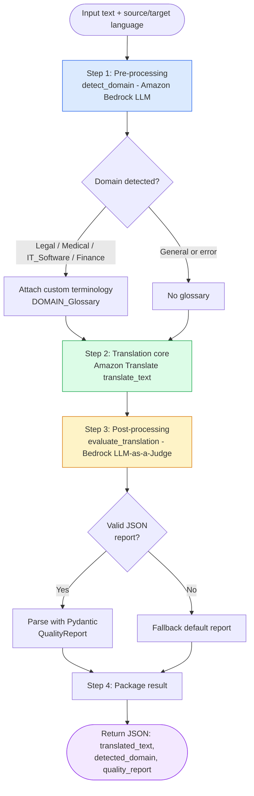
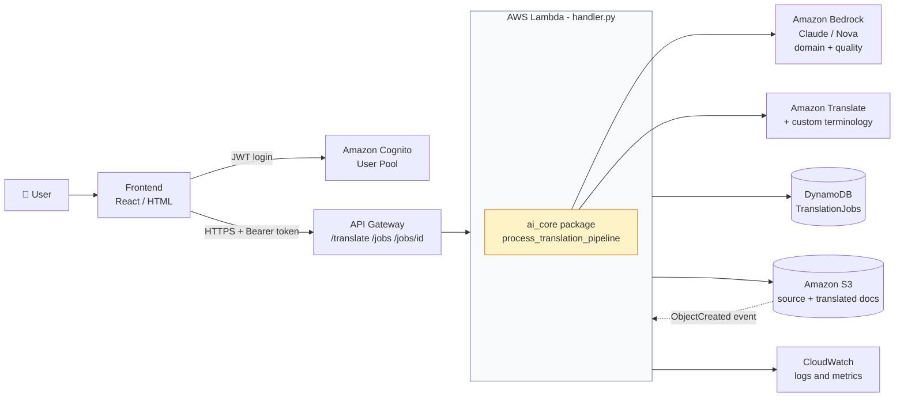
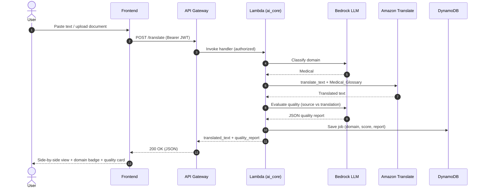
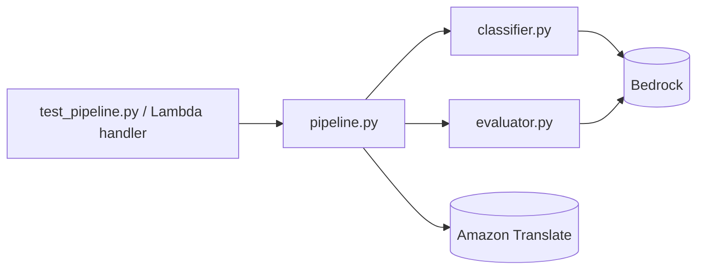
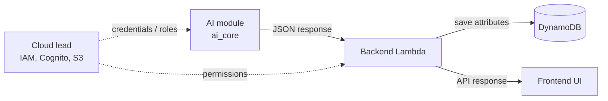
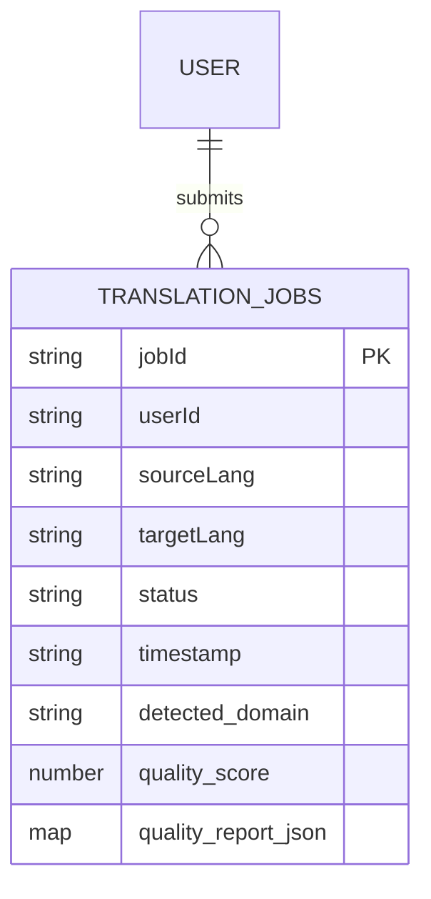
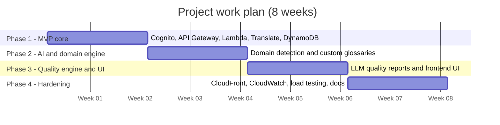

# 🌐 Translation AI Service

**AI/LLM core of the Serverless AI-Driven Language Translation System** — a context-aware, domain-intelligent translation pipeline built on AWS (Amazon Translate + Amazon Bedrock).

Unlike a plain text translator, this service **detects the document domain**, **locks domain terminology**, translates with a neural engine, and then **scores its own output** with an LLM-as-a-Judge, returning a structured **Quality Report** with every translation.

> 🎓 SRM University Delhi-NCR, Sonepat · Supervisor: Mr. Vikas Deswal
> 👥 Team: Rashi Kaushik, Rakshita, Chiranjan Bora, Suhani

---

## 📑 Table of Contents

1. [Why it is different](#-why-it-is-different)
2. [AI pipeline flowchart](#-ai-pipeline-flowchart)
3. [System architecture](#-system-architecture)
4. [Request sequence](#-request-sequence)
5. [Project structure](#-project-structure)
6. [Getting started](#-getting-started)
7. [Usage and sample output](#-usage-and-sample-output)
8. [Integration contract](#-integration-contract-for-the-team)
9. [Data model](#-data-model-dynamodb)
10. [Roadmap](#-roadmap)
11. [Security notes](#-security-notes)

---

## ✨ Why it is different

| Feature | Standard translator (e.g. Google Translate) | **Translation AI Service** |
|---|---|---|
| Target | General-purpose text strings | Enterprise documents and domain text |
| Domain adaptation | Limited / manual | **Automatic domain detection** (Legal, Medical, IT, Finance) |
| Terminology | None | **Custom glossary lock** via Amazon Translate terminologies |
| Quality control | None (raw output) | **LLM quality score + report** (fluency, terminology, issues) |
| Infrastructure | Fixed servers | **Serverless AWS** (Lambda, API Gateway, S3, DynamoDB) |
| Security / audit | Basic web form | Cognito auth, IAM roles, CloudWatch logs |
| Cost model | Always-on hardware | Pay-per-use, scales to zero |

---

## 🔄 AI pipeline flowchart

The core function `process_translation_pipeline()` runs three stages: **pre-processing**, **translation**, **post-processing**.



---

## 🏗️ System architecture

Your AI module (`ai_core/`) plugs into the serverless backend as a library inside the Lambda function.



---

## 📡 Request sequence



---

## 📁 Project structure

```text
translation-ai-service/
├── ai_core/
│   ├── __init__.py        # exports process_translation_pipeline
│   ├── classifier.py      # detect_domain()      - Bedrock domain classifier
│   ├── evaluator.py       # evaluate_translation() - LLM quality scoring (Pydantic)
│   └── pipeline.py        # process_translation_pipeline() - master orchestrator
├── test_pipeline.py       # local end-to-end test
├── requirements.txt
└── .gitignore
```



---

## 🚀 Getting started

### Prerequisites

- Python 3.10+
- An AWS account with access to **Amazon Translate** and **Amazon Bedrock** (enable the Claude / Nova models in your region)
- VS Code with the *Python* and *AWS Toolkit* extensions (recommended)

### Setup

```bash
# 1. Clone
git clone https://github.com/csquare14/translation-ai-service.git
cd translation-ai-service

# 2. Virtual environment
python -m venv venv
source venv/bin/activate        # Windows: venv\Scripts\activate

# 3. Dependencies
pip install -r requirements.txt

# 4. AWS credentials (use YOUR OWN IAM user - never share keys)
aws configure
```

`requirements.txt`

```text
boto3
botocore
pydantic
```

### Required IAM permissions

Ask the Cloud/DevOps lead for a dedicated IAM user with only:

- `bedrock:InvokeModel` / `bedrock:Converse`
- `translate:TranslateText`

### Custom terminology (glossaries)

Upload one terminology per domain, named `<Domain>_Glossary` (e.g. `Medical_Glossary`, `Legal_Glossary`, `IT_Software_Glossary`, `Finance_Glossary`):

```bash
aws translate import-terminology \
  --name Medical_Glossary \
  --merge-strategy OVERWRITE \
  --data-file fileb://Medical.csv \
  --terminology-data Format=CSV
```

---

## 🧪 Usage and sample output

```python
from ai_core import process_translation_pipeline

result = process_translation_pipeline(
    "The patient presents with severe acute myocardial infarction.",
    source_lang="en",
    target_lang="es",
)
print(result)
```

Run the bundled test:

```bash
python test_pipeline.py
```

Example response:

```json
{
  "source_language": "en",
  "target_language": "es",
  "detected_domain": "Medical",
  "translated_text": "El paciente presenta un infarto agudo de miocardio grave.",
  "quality_report": {
    "quality_score": 92,
    "fluency_rating": "High",
    "terminology_accuracy": "High",
    "flagged_issues": [],
    "suggestions": "Translation is accurate and uses correct medical terminology."
  }
}
```

---

## 🤝 Integration contract for the team

| Member | Role | What they consume / provide |
|---|---|---|
| **AI/LLM Engineer** | `ai_core/` | Provides `process_translation_pipeline(text, source_lang, target_lang)` |
| **Backend / API** | Lambda + API Gateway | Imports `ai_core` into `handler.py`; returns the JSON above |
| **Cloud / DB** | Cognito, S3, DynamoDB, IAM | Stores AI outputs; gives Lambda an IAM execution role |
| **Frontend** | React UI | Renders domain badge, side-by-side text, quality card |



**Response keys the frontend should use:** `detected_domain`, `translated_text`, `quality_report.quality_score`, `quality_report.flagged_issues`, `quality_report.suggestions`.

---

## 🗄️ Data model (DynamoDB)



---

## 🗺️ Roadmap



| Phase | Weeks | Focus | Status |
|---|---|---|---|
| 1 | 1-2 | Core serverless pipeline, baseline translation (`run_base_translation`) | 🔄 |
| 2 | 3-4 | Domain classifier + glossary lock | 🔄 |
| 3 | 5-6 | LLM quality evaluator + Quality Report UI | 🔄 |
| 4 | 7-8 | CloudFront, CloudWatch, audit logs, load testing | ⏳ |

---

## 🔒 Security notes

- **Never commit AWS keys** — keep `.env`, `~/.aws/credentials` and `venv/` in `.gitignore`.
- Each developer uses an **individual IAM user** with least privilege; do not share access keys.
- In production, Lambda uses an **IAM execution role** (temporary credentials), not stored keys.
- API routes are protected with **Amazon Cognito** JWT authorizers.

Suggested `.gitignore`:

```text
venv/
__pycache__/
*.pyc
.env
.aws/
```

---

## 📄 License

Academic project - add a license of your choice (e.g. MIT) before public release.