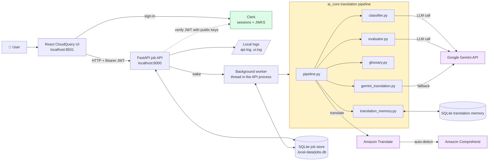
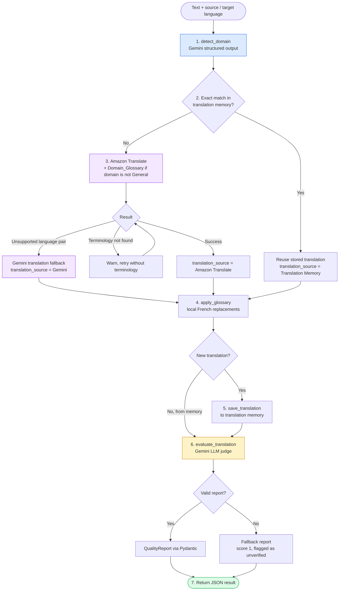
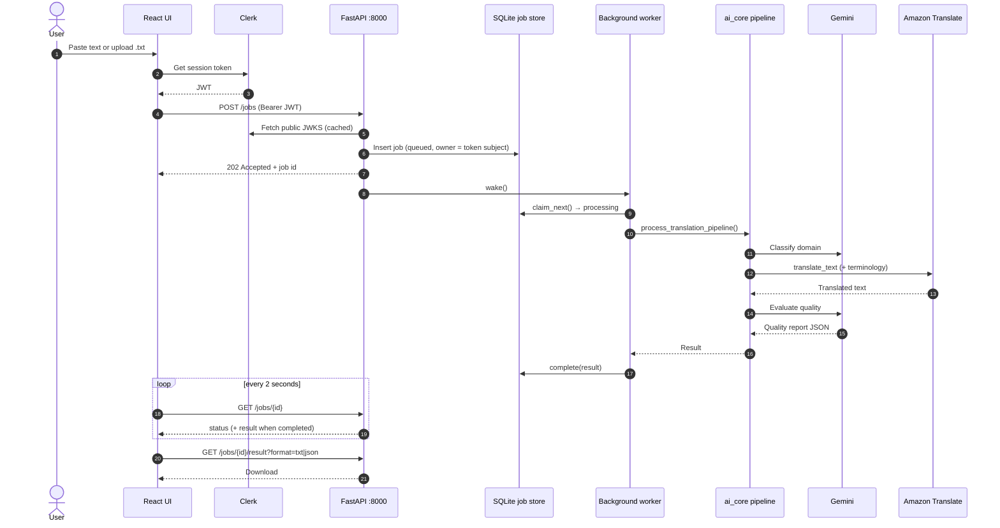
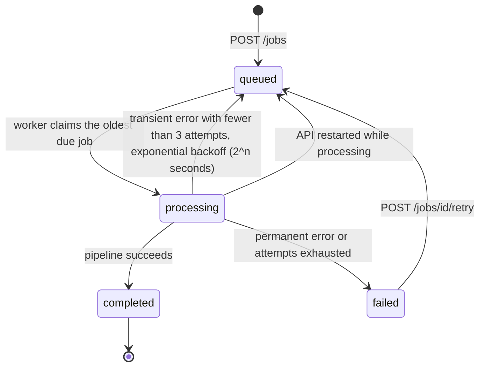
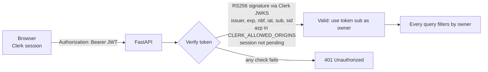
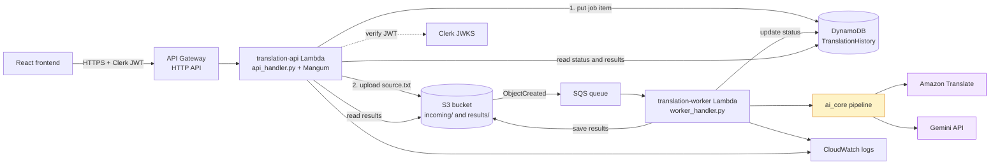
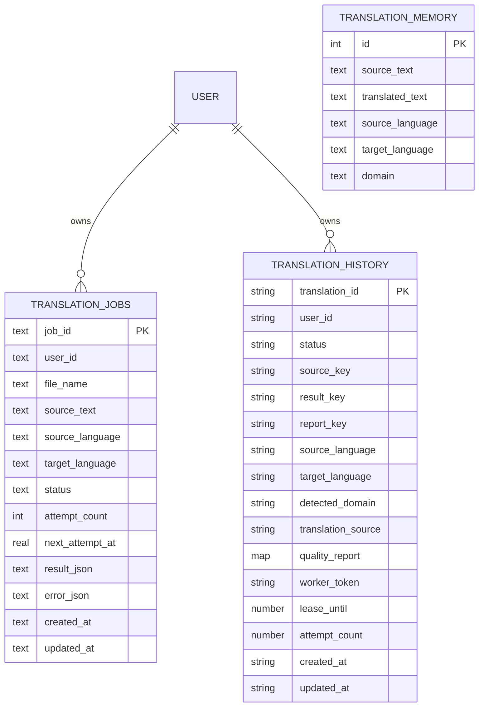

# 🌐 Translation AI Service

**A domain-aware, authenticated translation platform** that combines **Amazon Translate**, **Google Gemini**, a local **translation memory** and **domain glossaries**, and returns a structured **quality report** with every translation.

Unlike a plain text translator, the service **detects the document domain**, **reuses previous translations**, **applies domain terminology**, translates through a job queue with automatic retries, and then **scores its own output** with an LLM judge. Users sign in with **Clerk**, and every job is owned by and visible only to the user who created it.

> 🎓 SRM University Delhi-NCR, Sonepat · Supervisor: Mr. Vikas Deswal
>
> 👥 Team: Rashi Kaushik, Rakshita, Chiranjan Bora, Suhani

---

## Table of contents

1. [Highlights](#highlights)
2. [Architecture](#architecture)
3. [Translation workflow](#translation-workflow)
4. [Job lifecycle](#job-lifecycle)
5. [Authentication](#authentication)
6. [Deployment modes](#deployment-modes)
7. [Project structure](#project-structure)
8. [Getting started](#getting-started)
9. [Configuration](#configuration)
10. [API reference](#api-reference)
11. [Sample output](#sample-output)
12. [Data model](#data-model)
13. [Security dashboard](#security-dashboard)
14. [Testing](#testing)
15. [Known limitations](#known-limitations)
16. [Security notes](#security-notes)
17. [License](#license)

---

## Highlights

| Capability | How it works |
|---|---|
| **Domain detection** | Gemini classifies the text as `Legal`, `Medical`, `IT_Software`, `Finance` or `General` using schema-constrained JSON output |
| **Primary translation** | Amazon Translate (region `ap-south-1`), with an AWS custom terminology named `<Domain>_Glossary` when one exists |
| **Automatic source-language detection** | Amazon Translate calls Amazon Comprehend when the source language is `auto` |
| **Unsupported language pairs** | Gemini translates pairs that Amazon Translate rejects (`UnsupportedLanguagePairException`) |
| **Translation memory** | Exact-match SQLite cache keyed by source text + language pair + domain, so repeated text is never translated twice |
| **Local domain glossary** | Four domains with French replacements applied after translation |
| **Quality report** | Gemini scores the result (1–100), rates fluency and terminology, and lists flagged issues |
| **Persistent background jobs** | Jobs are stored in SQLite, processed by a background worker, retried automatically and recoverable after a restart |
| **Authentication** | Clerk sign-in; the API verifies session JWTs against Clerk's public keys and enforces per-user ownership |
| **Downloads** | Translated text (`.txt`) and the full report (`.json`) |
| **Security dashboard** | Resource graph, application paths, live S3 checks and per-job validation rules |
| **Optional AWS backend** | The same API can run on API Gateway + Lambda with S3, SQS and DynamoDB |

---

## Architecture

The diagram below shows the **local application** running on a Windows computer, and the **online services** it calls.


> The diagram shows the original Streamlit interface. The default frontend is now a **React (Vite) app called CloudQuery** that talks to the same FastAPI service on the same port. Streamlit is still available with `python run_local.py --streamlit`.

### Component view



---

## Translation workflow

The workflow image shows the eight stages of one request, from user input to the stored result.


`ai_core.pipeline.process_translation_pipeline()` implements the translation stages in this order:



| Stage in the workflow image | Where it happens in the code |
|---|---|
| 1. User input | React UI (or Streamlit) → `POST /jobs` or `POST /jobs/upload` |
| 2. Authentication | `backend/jobs/auth.py` verifies the Clerk JWT. Gemini access uses `GEMINI_API_KEY` in `ai_core/llm.py` |
| 3. Domain detection | `ai_core/classifier.py` (Gemini) |
| 4. Glossary selection | AWS terminology `<Domain>_Glossary` plus the local glossary in `ai_core/glossary.py` |
| 5. Translation | Amazon Translate, with Gemini as the fallback for unsupported pairs |
| 6. Quality evaluation | `ai_core/evaluator.py` (Gemini) |
| 7. Validation | The report is validated against the `QualityReport` Pydantic schema; failures produce an explicit fallback report |
| 8. Result & storage | The job store keeps the result and report; downloads are served from `/jobs/{id}/result` |

### Request sequence (local mode)



---

## Job lifecycle



- **Retryable errors:** throttling, timeouts, connection errors and HTTP 429/500/502/503/504 from the AI service.
- **Permanent errors** such as a missing AWS permission are shown to the user with a plain-language message and an error code. They can be retried manually after the cause is fixed.
- In AWS mode the initial `awaiting_upload` status is shown to clients as `queued`.

---

## Authentication



- A Clerk **secret key is not required**. Verification uses only the public keys.
- `CLERK_ISSUER` is derived from the publishable key when it is not set.
- **Demo mode** (`python run_local.py --demo`) accepts loopback requests only and uses one shared `local-demo` owner. It does not demonstrate authentication or multi-user isolation.

---

## Deployment modes

| | **Local (default)** | **AWS-backed** (optional) |
|---|---|---|
| Frontend | React on `localhost:8501` | Same app, `VITE_API_BASE_URL` points to API Gateway |
| API | Uvicorn on `localhost:8000` | `api_handler.handler` on Lambda via Mangum, API Gateway HTTP API |
| Job store | SQLite `.local-data/jobs.db` | DynamoDB table + S3 `incoming/{job_id}/source.txt` |
| Worker | Thread inside the API process | `worker_handler.handler` on Lambda, triggered by S3 → SQS |
| Results | SQLite | S3 `results/{job_id}/output.txt` and `report.json` |
| Select with | `JOB_BACKEND=local` | `JOB_BACKEND=aws` |



Key design points of the AWS mode:

- The DynamoDB record is created **before** the S3 upload, so the worker never sees an object without a job.
- The worker claims a job with a **conditional update and a lease token**, so concurrent or retried invocations cannot process the same job twice.
- The API Lambda and the worker Lambda are **separate packages with separate IAM roles**. Gemini credentials belong only on the worker.

---

## Project structure

```text
translation-ai-service/
├── ai_core/                    # Translation pipeline (library used by worker and Lambda)
│   ├── pipeline.py             # process_translation_pipeline() – orchestrator
│   ├── classifier.py           # detect_domain() – Gemini classifier
│   ├── evaluator.py            # evaluate_translation() – LLM judge + QualityReport schema
│   ├── gemini_translation.py   # Fallback translation for unsupported AWS language pairs
│   ├── glossary.py             # Local domain glossary (French replacements)
│   ├── translation_memory.py   # SQLite exact-match translation cache
│   ├── llm.py                  # Shared Gemini client with structured JSON output
│   └── advanced/               # Bedrock-based RCA / impact / what-if / remediation (not wired in)
├── backend/
│   ├── jobs/
│   │   ├── apis.py             # FastAPI app and routes
│   │   ├── auth.py             # Clerk JWT verification
│   │   ├── config.py           # Environment configuration
│   │   ├── store.py            # SQLite job store
│   │   ├── aws_store.py        # S3 + DynamoDB job store (JOB_BACKEND=aws)
│   │   └── worker.py           # Background worker, retries, failure classification
│   ├── aws/
│   │   ├── clients.py          # boto3 clients (Translate, S3, DynamoDB)
│   │   └── storage.py          # S3 / DynamoDB helpers
│   └── app/
│       ├── security/           # Security routes, rule engine, resource graph, attack paths
│       └── analytics/          # SQL usage analytics (standalone, see limitations)
├── frontend/
│   ├── web/                    # React + Vite + TypeScript CloudQuery app
│   └── clerk/                  # Clerk component used by the Streamlit UI
├── docs/images/                # Architecture and workflow diagrams
├── main.py                     # Original Streamlit UI (run_local.py --streamlit)
├── run_local.py                # One-command launcher for API + frontend
├── api_handler.py              # Lambda entry point for the API
├── worker_handler.py           # Lambda entry point for the translation worker
├── build_lambda.py             # Builds dist/translation-worker.zip or translation-api.zip
├── aws-api-security-read-policy.json   # Read-only S3 permissions for the API role
├── aws-audit-policy.json               # Read-only audit permissions
├── LOCAL_SETUP.md              # Detailed Windows setup and AWS deployment notes
├── requirements.txt            # Local dependencies
├── requirements-lambda.txt     # Worker Lambda dependencies
├── requirements-api-lambda.txt # API Lambda dependencies
└── test_*.py                   # Backend test suites
```

---

## Getting started

### Prerequisites

- Python 3.10+ (the Lambda packages target **Python 3.12**)
- Node.js (for the React frontend)
- An AWS account with **Amazon Translate** and **Amazon Comprehend** access
- A **Gemini API key**
- A **Clerk** development application (or use `--demo` for a single-user trial)

### Install and run

```powershell
# Python dependencies
python -m venv venv
venv\Scripts\activate
pip install -r requirements.txt

# Frontend dependencies
cd frontend\web
npm install
cd ..\..

# Start the API and the frontend together
python run_local.py
```

Open **http://localhost:8501**. The interactive API documentation is at **http://127.0.0.1:8000/docs**. Press `Ctrl+C` to stop both servers.

| Command | Result |
|---|---|
| `python run_local.py` | Clerk-authenticated React app |
| `python run_local.py --demo` | Single-user demo, no sign-in |
| `python run_local.py --streamlit` | Original Streamlit interface |

The launcher runs **one** Uvicorn worker and refuses to start if port 8000 or 8501 is already in use. Clerk setup, AWS credential notes and deployment steps are in **[LOCAL_SETUP.md](LOCAL_SETUP.md)**.

### Use the application

1. Sign in, choose the source language (or **Auto-detect**) and the target language.
2. Paste text or upload a UTF-8 `.txt` file (at most **10,000 bytes**).
3. Submit. The job appears in your history and updates automatically.
4. Download the translation and the JSON quality report.
5. Retry a failed job after fixing its input or configuration.

### React app pages

| Route | Page |
|---|---|
| `/` | Overview |
| `/translation` | Translation workspace |
| `/history` | Job history |
| `/jobs/:id` | Job detail |
| `/resources` | Resource graph |
| `/attack-paths` | Attack path analysis |
| `/security` | Security insights |
| `/reports` | Reports (CSV, JSON, Print / Save as PDF) |
| `/settings` | Settings (including reduced-motion toggle) |

### Build the Lambda packages

```bash
python build_lambda.py          # dist/translation-worker.zip  (handler: worker_handler.handler)
python build_lambda.py --api    # dist/translation-api.zip     (handler: api_handler.handler)
```

Both packages target Linux x86_64 / Python 3.12 and use an explicit source allowlist, so `.env` files and local databases are never packaged.

---

## Configuration

Put values in `.env` (and Clerk keys in `.env.local`, which is loaded first). Neither file is committed.

| Variable | Purpose | Default |
|---|---|---|
| `GEMINI_API_KEY` | Gemini access for classification, evaluation and fallback translation | required |
| `GEMINI_MODEL` | Gemini model name | `gemini-3.5-flash-lite` |
| `AWS_REGION` | Region for Translate, S3 and DynamoDB | `ap-south-1` |
| `LOCAL_AUTH_MODE` | `clerk` or `demo` | `clerk` |
| `CLERK_PUBLISHABLE_KEY` | Clerk publishable key | – |
| `CLERK_ISSUER` | Clerk Frontend API URL (HTTPS) | derived from the publishable key |
| `CLERK_ALLOWED_ORIGINS` | Allowed frontend origins (CORS and token `azp`) | `http://localhost:8501,http://127.0.0.1:8501` |
| `CLERK_AUDIENCE` | Only if your session tokens carry an audience | unset |
| `JOB_BACKEND` | `local` (SQLite) or `aws` (S3 + DynamoDB) | `local` |
| `S3_BUCKET_NAME` | Bucket for sources and results | AWS mode |
| `TRANSLATION_HISTORY_TABLE` | DynamoDB table name | `TranslationHistory` |
| `LOCAL_DATA_DIR` | Location of `jobs.db` and logs | `.local-data` |
| `TRANSLATION_MEMORY_DB_PATH` | Location of the translation memory database | `ai_core/translation_memory.db` (`/tmp` on Lambda) |
| `VITE_API_BASE_URL` | Frontend API base URL when using the deployed API | – |

### Required AWS permissions

| Identity | Permissions |
|---|---|
| Local user / worker | `translate:TranslateText`, `comprehend:DetectDominantLanguage` (needed for auto-detect) |
| API Lambda role | DynamoDB `PutItem/GetItem/UpdateItem/Scan` on the history table, S3 `PutObject/GetObject` on `incoming/*`, S3 `GetObject` on `results/*`, plus the read-only checks in `aws-api-security-read-policy.json` |
| Worker Lambda role | S3 read/write for its objects, DynamoDB `GetItem/UpdateItem`, Translate and Comprehend, basic CloudWatch logging |

Permissions given to a developer's CLI user do **not** apply to Lambda. Each Lambda needs its own execution role.

### Custom terminology (optional)

Create one terminology per domain, named `<Domain>_Glossary` (`Legal_Glossary`, `Medical_Glossary`, `IT_Software_Glossary`, `Finance_Glossary`):

```bash
aws translate import-terminology \
  --name Medical_Glossary \
  --merge-strategy OVERWRITE \
  --data-file fileb://Medical.csv \
  --terminology-data Format=CSV
```

If a terminology does not exist, the pipeline logs a warning and continues with standard translation.

---

## API reference

All job routes require `Authorization: Bearer <Clerk session token>` in Clerk mode. Ownership is enforced on every route.

| Method | Path | Description |
|---|---|---|
| `GET` | `/health` | Service status and auth mode (public) |
| `GET` | `/auth/config` | Clerk publishable key and configuration state (public) |
| `GET` | `/auth/me` | Verified user id |
| `POST` | `/jobs` | Create a job from JSON text (`202`) |
| `POST` | `/jobs/upload` | Create a job from a multipart `.txt` file (`202`) |
| `GET` | `/jobs` | List your jobs (`limit` 1–100) |
| `GET` | `/jobs/{id}` | Job status, error and result |
| `GET` | `/jobs/{id}/source` | Original submitted text |
| `GET` | `/jobs/{id}/result?format=txt\|json` | Download the translation or the report |
| `POST` | `/jobs/{id}/retry` | Retry a `failed` job (`409` otherwise) |
| `GET` | `/security/overview` | Topology, live storage checks, application paths |
| `GET` | `/security/jobs/{id}/check` | Rule-based validation of one owned job |

Request body for `POST /jobs`:

```json
{
  "text": "The patient presents with severe acute myocardial infarction.",
  "source_language": "auto",
  "target_language": "es",
  "file_name": "note.txt"
}
```

Input rules: non-empty UTF-8 text, at most 10,000 bytes, and different source and target languages.

---

## Sample output

Calling the pipeline directly:

```python
from ai_core.pipeline import process_translation_pipeline

result = process_translation_pipeline(
    "The patient presents with severe acute myocardial infarction.",
    source_lang="en",
    target_lang="es",
)
```

Illustrative result (values vary by model and AWS configuration):

```json
{
  "source_language": "en",
  "target_language": "es",
  "detected_domain": "Medical",
  "translated_text": "El paciente presenta un infarto agudo de miocardio grave.",
  "translation_source": "Amazon Translate",
  "quality_report": {
    "quality_score": 92,
    "fluency_rating": "High",
    "terminology_accuracy": "High",
    "flagged_issues": [],
    "suggestions": "Translation is accurate and uses correct medical terminology."
  }
}
```

`translation_source` is one of `Translation Memory`, `Amazon Translate` or `Gemini`. If the quality evaluator is unavailable, the report has `quality_score: 1`, a flagged issue saying so, and a suggestion to review manually. That score is **not** a verified evaluation.

---

## Data model



| Entity | Store | Used in |
|---|---|---|
| `TRANSLATION_JOBS` | SQLite `.local-data/jobs.db` | Local mode |
| `TRANSLATION_MEMORY` | SQLite `translation_memory.db` | Both modes |
| `TRANSLATION_HISTORY` | DynamoDB | AWS mode |

---

## Security dashboard

The Resource Graph, Attack Path Analysis and Security Insights pages share one API-backed dashboard in Clerk mode.

- **Resource graph:** the *configured* application topology (frontend, Clerk, API Gateway, API Lambda, S3, SQS, worker Lambda, DynamoDB), not a discovered account inventory.
- **Application paths:** bounded connectivity paths from the browser to the bucket and table. The selected route highlights its edges.
- **Storage checks:** S3 default encryption and public-access blocks report `passed`, `failed` or `unknown`. Unknown means *not verified*, not *safe*.
- **Attack assessment:** stays `not_assessed` until effective network and IAM evidence exists. Ordinary connections are never presented as exploitable paths.
- **Demo mode** keeps the clearly labelled sample scenario. Real API failures never fall back to demo findings.

**Job validation rules** (`/security/jobs/{id}/check`):

| Rule | Severity | Checks |
|---|---|---|
| `SEC001` | High | Job status is one of the allowed values |
| `SEC002` | High | Job has a user identity |
| `SEC003` | Medium | Job has a target language |
| `SEC004` | High | File extension is `.txt` |
| `SEC005` | High | Job has an id |
| `SEC006` | High | Job payload is a dictionary |

> These checks are **not** an enterprise security certification or a full IAM audit.

---

## Testing

```bash
# Backend (unittest)
python -m unittest test_local_jobs test_worker test_aws_store test_security_api \
                   test_glossary_integration test_translation_fallback

# Frontend
cd frontend/web
npm test
npm run build
```

`test_pipeline.py` is a manual end-to-end run and calls the real AWS and Gemini services.

---

## Known limitations

- Input is **plain UTF-8 text** (`.txt`), at most **10,000 bytes**. Other document formats are not supported.
- The **local glossary** has four terms per domain and applies to **French targets only**. AWS terminologies cover other languages when configured.
- The translation memory is an **exact-match** cache, not fuzzy matching. On Lambda it lives in `/tmp` and is not shared between instances.
- The local database has **no encryption at rest**. It relies on the file protections of your Windows account.
- AWS history uses a **Scan with an owner filter**. Add an owner/`created_at` index and switch to Query before scaling. Manually created items without a `user_id` are intentionally invisible.
- A **dead-letter queue** for the SQS worker is part of the separate AWS deployment and is not created by this repository. API Gateway deployment is also a separate step.
- `ai_core/advanced/` (root-cause analysis, impact, what-if, remediation) calls Amazon Bedrock and is **not connected** to the translation pipeline.
- `backend/app/analytics/` is a standalone Flask blueprint with SQL queries and is **not mounted** in the FastAPI app. Flask is not listed in `requirements.txt`.
- The API must run as a **single process**; the launcher enforces this.

---

## Security notes

- **Never commit secrets.** `.env`, `.env.local`, `.clerk/`, `.local-data/` and `venv/` are in `.gitignore`.
- Keep AWS and Gemini credentials out of frontend code. Use your existing credential chain locally and **IAM execution roles** on Lambda.
- Use a Clerk **development** application for localhost.
- Job content and provider responses are kept out of stored error records. Users see a short message and an error code.
- Prompts treat user text as **content to process, not instructions**, which reduces prompt-injection risk, but LLM output should still be reviewed for sensitive documents.

---

## License

Academic project. Add a license of your choice (for example MIT) before public release.